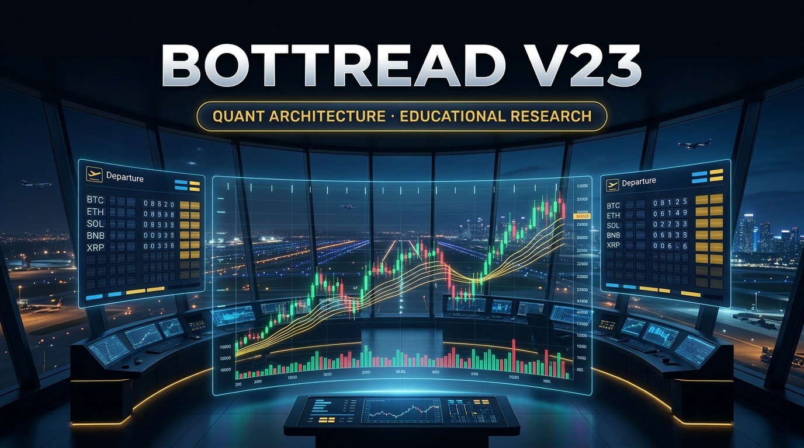
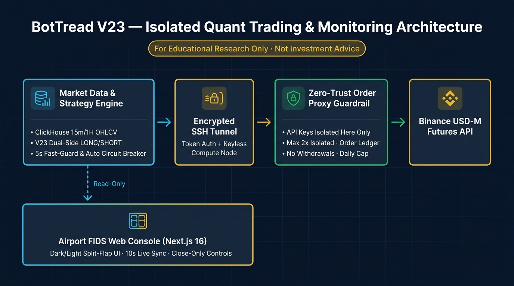
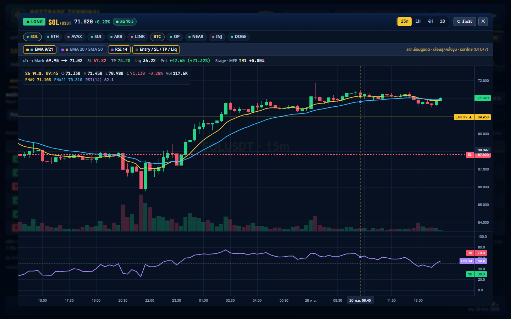
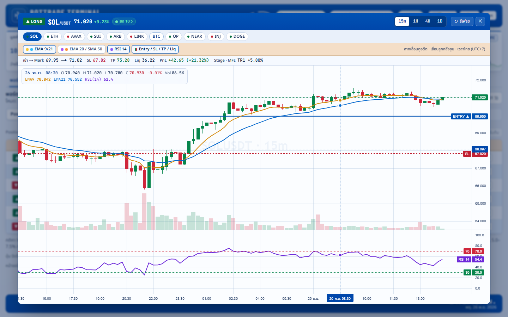
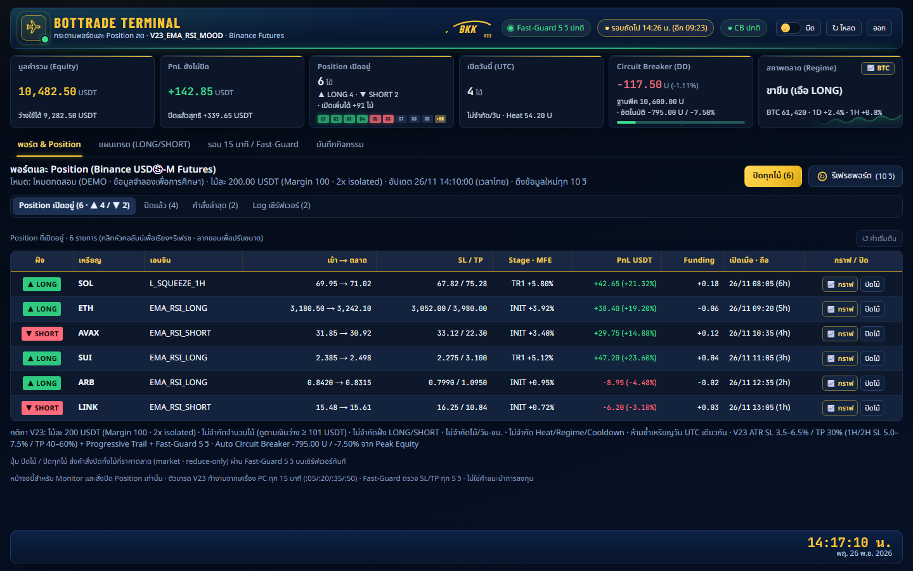
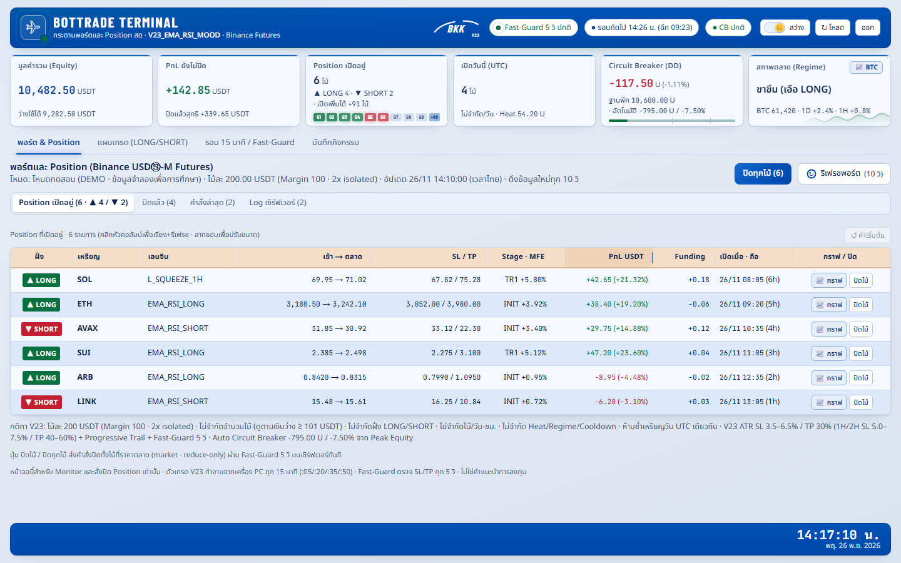
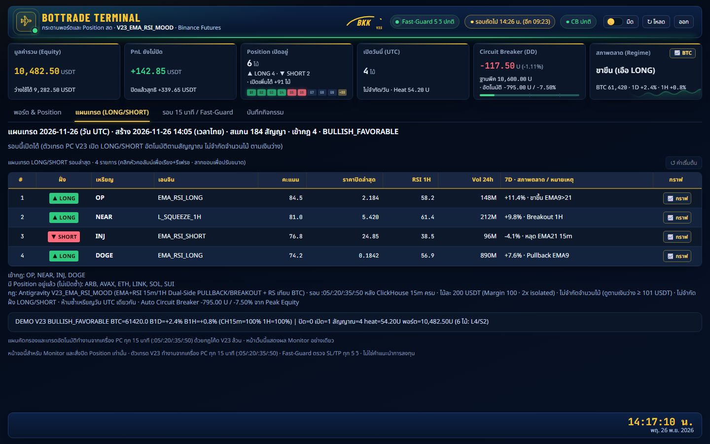
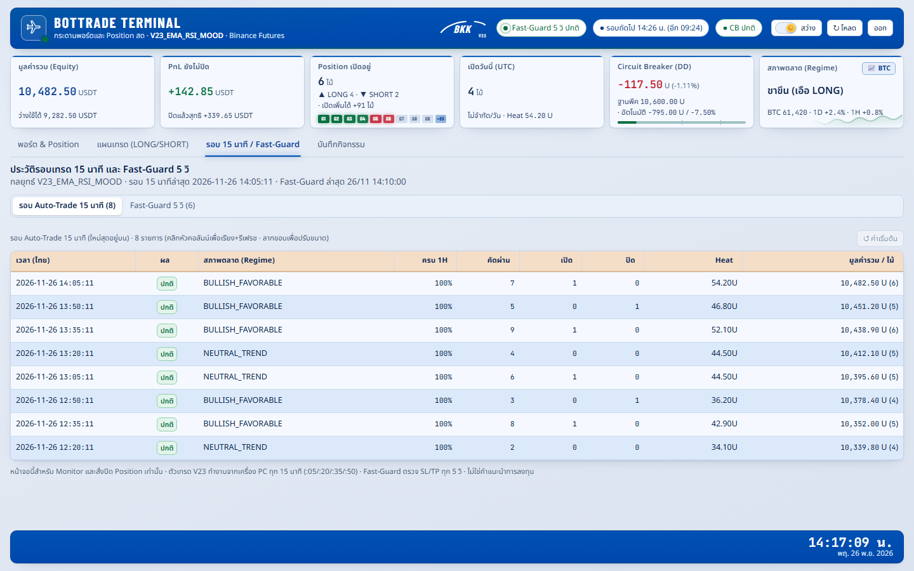
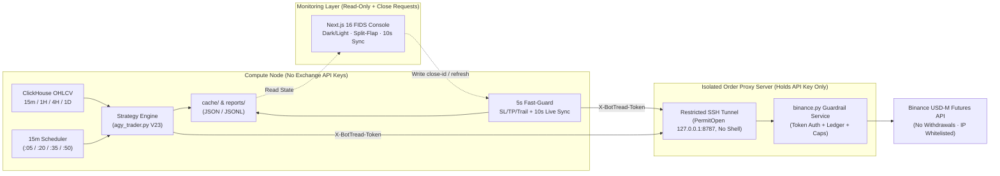
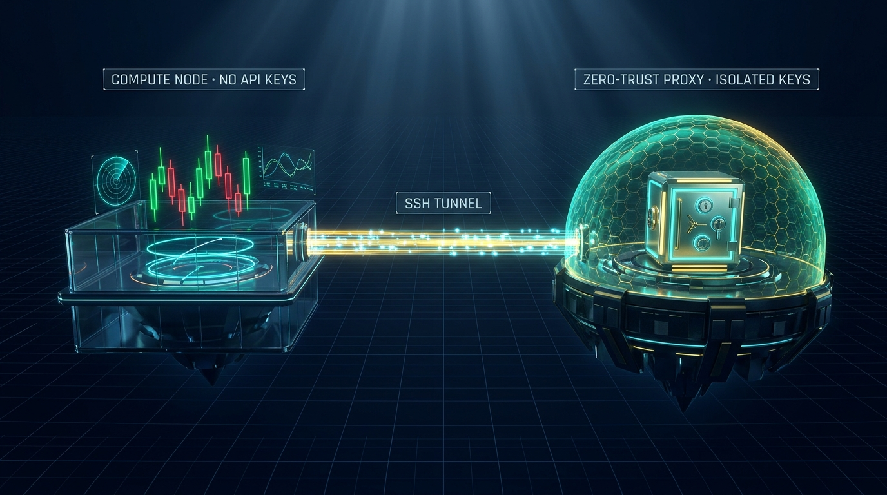

# BotTread — ระบบศึกษาการเทรดอัตโนมัติและ Monitor พอร์ตแบบแยกชั้นความปลอดภัย (Binance USDⓈ-M Futures)

<p align="center">
  
</p>

> [!CAUTION]
> **คำเตือนสำคัญ — จัดทำเพื่อการศึกษาและวิจัยด้านวิศวกรรมซอฟต์แวร์เท่านั้น (Educational Purpose Only)**
> - โปรเจกต์นี้สร้างขึ้นเพื่อศึกษาสถาปัตยกรรมระบบเทรดอัตโนมัติ (Quantitative Trading Architecture), การจัดการความเสี่ยงเชิงระบบ (Risk Controls), ระบบแยกกุญแจแบบ Zero-Trust Proxy, และการออกแบบหน้าจอ Monitor แบบ Real-time
> - **ไม่ใช่คำแนะนำการลงทุน (Not Financial / Investment Advice)** ไม่ได้ชักชวนหรือรับรองผลกำไรใดๆ การซื้อขายสัญญาซื้อขายล่วงหน้า (Futures) และการใช้ Leverage มีความเสี่ยงสูงมาก อาจสูญเสียเงินลงทุนทั้งหมดได้
> - ผลทดสอบย้อนหลัง (Backtest) หรือตัวอย่างหน้าจอในเอกสารนี้เป็นเพียงข้อมูลประกอบการศึกษา ไม่รับประกันผลในอนาคต ผู้ใช้งานต้องรับผิดชอบความเสี่ยงทั้งหมดด้วยตนเอง

<p align="center">
  
</p>

---

## Objective

**BotTread** ออกแบบเพื่อแยก **"สมองคิดกลยุทธ์และหน้าจอแสดงผล"** ออกจาก **"เซิร์ฟเวอร์ที่ถือ API Key และส่งคำสั่งจริง"** อย่างเด็ดขาด โดยมีเป้าหมายหลัก 4 ด้าน:

1. **Deterministic Code-First Execution (`agy_trader.py`)**: การคัดเหรียญ การคำนวณขนาดไม้ จุดตัดขาดทุน (SL/TP/Trailing) และ Circuit Breaker ทำด้วยโค้ดและเลขทศนิยมแม่นยำ (`Decimal` / `BigInt`) 100% ไม่มี binary float ในการคำนวณเงิน
2. **Zero-Trust Order Proxy (`binance.py`)**: API Key อยู่ที่เซิร์ฟเวอร์ Proxy เพียงจุดเดียว ล็อกสิทธิ์ห้ามถอนเงิน และจำกัดความเสียหายด้วยด่านตรวจฝั่งเซิร์ฟเวอร์ (เพดานขนาดไม้, เพดาน Leverage, เพดานจำนวนไม้ต่อวัน UTC, ตรวจ Spread, และ Append-Only Ledger)
3. **Real-Time Airport FIDS Web Console + TradingView Chart (`console/`)**: หน้าเว็บ Next.js สไตล์กระดานสนามบิน (รองรับโหมดมืด/สว่าง, Split-Flap Animation, รีเฟรชสดทุก 10 วินาที, และกราฟแท่งเทียนแบบ TradingView ด้วย `lightweight-charts` พร้อม Volume, EMA 9/21/20, SMA 50, RSI 14, และเส้น Entry/SL/TP/Liq) สำหรับติดตามพอร์ตและสั่งปิดไม้เท่านั้น (ไม่ถือ API Key และไม่เปิดไม้เอง)
4. **Multi-Agent Event-Driven Lab (`team.py` + Redpanda/Kafka)**: ชุดเวิร์กโฟลว์ทดลองทีม 7 สมาชิก (4 บอท + 3 AI Agent) สื่อสารผ่าน Kafka API เพื่อศึกษาการวิเคราะห์กราฟและสรุปรายงานโดยไม่ให้ AI มีสิทธิ์แก้ตัวเลขหรือส่งคำสั่งตรง

---

## ภาพประกอบหน้าจอตัวอย่าง (DEMO UI Showcase — ข้อมูลจำลอง 100%)

> *ภาพหน้าจอทั้งหมดด้านล่างบันทึกจากโหมดข้อมูลจำลองเพื่อการศึกษา (**DEMO**) ไม่ใช่ยอดเงินหรือพอร์ตจริง*

### 1. กราฟแท่งเทียน Interactive สไตล์ TradingView (Candlestick + Volume + EMA + RSI 14 + Entry/SL/TP)

| กราฟ TradingView — โหมดมืด (Dark) | กราฟ TradingView — โหมดสว่าง (Light) |
|---|---|
|  |  |

### 2. กระดานพอร์ตและ Position สด (โหมดมืด & โหมดสว่าง — Airport FIDS Style)

| โหมดมืด (Midnight Aviation · Dark) | โหมดสว่าง (Terminal Cobalt · Light) |
|---|---|
|  |  |

### 3. แผนเทรดอัตโนมัติ (LONG/SHORT) และประวัติรอบ 15 นาที / Fast-Guard 5 วิ

| แผนเทรด (LONG/SHORT) | ประวัติรอบ 15 นาที & Fast-Guard |
|---|---|
|  |  |

### แนวคิดระบบ Multi-Agent ผ่าน Kafka (โหมดทดลอง `team.py`)

<p align="center">
  
</p>

---

## Workflow

### สถาปัตยกรรมภาพรวม (3-Tier Isolation)



### 1. รอบเทรดหลัก (`agy_trader.py` — V23 Dual-Side Strategy)
- **ความถี่**: รันทุก 15 นาทีที่นาที `:05 / :20 / :35 / :50` ผ่าน `agy_scheduler.py` โดยรอให้ ClickHouse เก็บแท่งเทียน 15m ที่เพิ่งปิดครบก่อนจึงสแกน
- **คัดกรองสองฝั่ง (Dual-Side LONG & SHORT)**:
  - ใช้โครงสร้าง EMA + RSI 15m/1H (Pullback-to-EMA9 หรือ Fresh 16-bar Breakout) คัดกรองความแข็งแกร่งเทียบ BTC (`Relative Strength`), ป้องกันการไล่ราคาไกล EMA21 (`≤ 2.5%`), ตรวจ Funding Rate Guard, และผสานชุดเอนจิน 1H/2H
  - ตั้ง Stop Loss แบบปรับตามความผันผวนด้วย `ATR(14) 1H` (`clip(2.5 × ATR14, 3.5%, 6.5%)`) และ Take Profit `30%` (หรือ `40%–60%` สำหรับเอนจิน 1H/2H)
- **ขนาดไม้และการเปิดตำแหน่ง**:
  - Margin ไม้ละ **`100 USDT` × `2x isolated`** = Notional **`200 USDT`** (`LOT_USDT`)
  - ไม่ล็อกจำนวนไม้ตายตัว (`MAX_OPEN = 0`) เปิดตามเงินว่างจริง (`available_usdt ≥ 101 USDT`) ไม่จำกัดฝั่ง LONG/SHORT และห้ามเปิดเหรียญซ้ำในวัน UTC เดียวกันตามกฎ Idempotent ของ Proxy
- **ระบบเฝ้าระวังทุก 5 วินาที (`fast-guard`)**:
  - ซิงก์พอร์ตสดจาก Binance ทุก 10 วินาทีตามเวลาเครื่อง (`:00/:10/:20/:30/:40/:50`)
  - **3-Stage Progressive Runner Trail**: เมื่อกำไรสูงสุดระหว่างถือ (`MFE`) แตะ `+5%` บีบ SL เหลือ `-1%`, แตะ `+8%` ล็อกกำไร `+2.5%`, แตะ `+13% / +22% / +30%` ไล่ตามที่ `MFE - 4.5% / 3.5% / 2.5%`
  - **Multi-Channel Squeeze / Crash Defense**: ตัดไม้ที่ยังไม่มีกำไรล็อกทันทีเมื่อ BTC 15m/1H/4H, ETH 15m หรือความกว้างตลาด (Breadth 1H) พุ่ง/ร่วงฉับพลัน
  - **Auto Safe Circuit Breaker (High-Water Mark)**: คำนวณจุดตัดขาดทุนอัตโนมัติด้วย `Decimal` จาก Peak Equity (`1x = 5.0%`, เพิ่ม `+2.5%` ต่อ `+1x`, เพดานสูงสุด `10.0%`, ขั้นต่ำ `20 USDT`) → สำหรับ `2x` จะตัดที่ **`-7.50%` จาก Peak Equity** (หยุดเปิดไม้ใหม่ แต่ยังปิดไม้เดิมได้จนกว่าผู้ใช้จะสั่งรีเซ็ต)

### 2. ด่านความปลอดภัยฝั่ง Order Proxy (`binance.py`)
- รับคำขอเฉพาะบน `127.0.0.1:8787` (ผ่าน systemd socket activation เพื่อกันผู้ใช้เครื่องเดียวกันแย่งพอร์ต) และเข้าถึงจากเครื่องคำนวณได้ผ่าน SSH Tunnel แบบห้ามเปิด Shell (`PermitTTY no`, `PermitOpen 127.0.0.1:8787`) พร้อมตรวจ Header `X-BotTread-Token` แบบ constant-time (`hmac.compare_digest`)
- **Endpoints**:
  - `POST /open`: ตรวจ `run_id` (วันนี้/เมื่อวาน UTC เท่านั้น), รหัสคำสั่งไม่ซ้ำ (`bto-<run_id>-<coin>`), ไม่เกิน `SHORT_LOT_USDT`, Leverage ไม่เกิน `MAX_LEVERAGE`, ไม่เกิน `DAILY_OPEN_CAP` (20 ไม้/วัน UTC), บัญชีเป็น One-way + Single-Asset Mode, ไม่ยุ่งเหรียญที่เจ้าของถืออยู่เอง, และ Spread ≤ `0.5%`
  - `POST /close`: ปิดเฉพาะไม้ที่อยู่ใน Ledger ของบอทด้วยคำสั่ง `reduceOnly` ตามจำนวนจริง
  - `POST /sync`, `GET /portfolio`, `GET /check`: กระทบยอดคำสั่งที่ไม่รู้ผล (`unclear`), บันทึกกำไรขาดทุนสุทธิจริง (รวมค่าธรรมเนียมและ Funding) ลง Append-Only Ledger (`short-orders.jsonl`)

### 3. โหมด Multi-Agent Kafka Lab (`team.py` / `runner.py`)
- โครงสร้างเสริมใน `docker-compose.yml` ที่ใช้ Redpanda (Kafka API) เชื่อม 4 บอท (`Quant`, `Secretary`, `Clock`, `Trader`) และ 3 AI Agent (`Chart Analyst`, `Risk Critic`, `CIO`) สำหรับศึกษาการให้ AI อ่านกราฟและวิจารณ์ความเสี่ยงโดยมีตัวตรวจตัวเลข (`ollama.ungrounded`)
- **ข้อควรระวัง**: ห้ามรัน `bottread-team` พร้อมกับ `agy_trader.py` บนบัญชีเดียวกัน เลือกใช้ทีละระบบเท่านั้น

---

## Security & Secret Isolation (การป้องกันความลับ)

<p align="center">
  
</p>

โปรเจกต์นี้ออกแบบให้ปลอดภัยสำหรับการเผยแพร่ซอร์สโค้ดเพื่อการศึกษา โดยยึดหลักต่อไปนี้:

1. **ห้ามเก็บความลับใน Repository เด็ดขาด**:
   - ไฟล์ `.env`, `.env.*`, `console.env`, `console/.env*`, `*.pem`, `*.key`, `credentials*.json`, `cache/`, `reports/`, `research/`, `tmp/` ถูกกันไว้ใน [`.gitignore`](.gitignore) ทั้งหมด
   - มีเฉพาะไฟล์ตัวอย่างค่าปลอม [`.env.example`](.env.example) และ [`console/.env.example`](console/.env.example) เท่านั้นที่ถูกติดตามใน Git
2. **แยกชั้นสิทธิ์ (Least Privilege)**:
   - API Key ของ Exchange ต้องตั้งสิทธิ์เฉพาะ `Enable Reading` + `Enable Futures`, **ปิด `Enable Withdrawals` เสมอ**, และผูก `IP Whitelist` กับเซิร์ฟเวอร์ Proxy เท่านั้น
   - หน้าเว็บ Console ไม่ถือ API Key และไม่มี Endpoint เปิดไม้ (มีเฉพาะคำขอรีเฟรชพอร์ตและสั่งปิดไม้ผ่านไฟล์คำขอใน `cache/requests/` พร้อมคุกกี้ลงลายเซ็น `HttpOnly` + `SameSite=Strict` และระบบล็อกเมื่อใส่รหัสผิด 5 ครั้ง)
3. **การกรองข้อมูลก่อนบันทึกและก่อน Commit**:
   - โค้ดมีตัวกรอง IP สาธารณะก่อนเขียน Log (`scrub_text`) และแนะนำให้ใช้ pre-commit secret scanner ตรวจจับ API Key, Token, Private Key, อีเมลจริง และ IP สาธารณะก่อนทุก Commit

---

## Config

คัดลอกไฟล์ตัวอย่างแล้วกรอกค่าของสภาพแวดล้อมตนเอง (ห้าม commit ไฟล์จริง):

### 1. เครื่องประมวลผลหลัก (`.env` — ดูตัวอย่างใน [`.env.example`](.env.example))

| ตัวแปร | ค่าเริ่มต้น | คำอธิบาย |
|---|---|---|
| `CLICKHOUSE_HOST` / `PORT` | `127.0.0.1` / `8123` | ที่อยู่ฐานข้อมูล ClickHouse ที่เก็บแท่งเทียน OHLCV (อ่านอย่างเดียว) |
| `CLICKHOUSE_USER` / `PASSWORD` / `DATABASE` | `default` / ว่าง / `altcoin` | บัญชีและฐานข้อมูล ClickHouse |
| `DCA_PROXY_HOST` | *(เว้นว่าง = ปิดส่งคำสั่ง)* | ที่อยู่เซิร์ฟเวอร์ Order Proxy สำหรับเปิด SSH Tunnel |
| `DCA_PROXY_USER` / `DCA_PROXY_KEY` | `dcaproxy` / `~/.ssh/<proxy_key>` | ผู้ใช้ SSH แบบห้าม shell และ private key ของ Tunnel |
| `DCA_PLAN_TOKEN` | *(ต้องสุ่มยาว ≥ 32 ตัว)* | โทเคนลับที่ตรงกันทั้งฝั่งเครื่องคำนวณและฝั่ง Proxy |
| `DEEPSEEK_API_KEY` / `DEEPSEEK_HOST` | *(เฉพาะโหมด `team.py`)* | คีย์ LLM สำหรับโหมดทดลอง Multi-Agent Kafka |
| `KAFKA_BOOTSTRAP` | `127.0.0.1:19092` | Redpanda / Kafka broker (เฉพาะโหมด `team.py`) |

### 2. หน้าเว็บ Console (`console.env` หรือ `console/.env.local` — ดูตัวอย่างใน [`console/.env.example`](console/.env.example))

| ตัวแปร | ค่าเริ่มต้น | คำอธิบาย |
|---|---|---|
| `BOTTREAD_ROOT` | `/data` | โฟลเดอร์ที่มี `cache/` และ `reports/` |
| `CONSOLE_PASSWORD` | *(จำเป็น)* | รหัสผ่านเข้าสู่หน้าจอ Monitor |
| `CONSOLE_SECRET` | *(จำเป็น, ยาว ≥ 16 ตัว)* | กุญแจสุ่มสำหรับเซ็น HMAC session cookie |
| `PORT` | `3300` | พอร์ตของเว็บ Console |
| `LOG_TZ_OFFSET_MIN` | `420` | ชดเชยเขตเวลา Log (นาทีจาก UTC; เวลาไทย = `420`) |
| `TRUST_PROXY` / `COOKIE_SECURE` | `0` / `0` | ตั้งเป็น `1` เมื่อวางหลัง HTTPS Reverse Proxy |

### 3. เซิร์ฟเวอร์ Order Proxy (`/etc/bottread/dca.env` และ `/etc/bottread/plan.env` สิทธิ์ `root:root 600`)

| ตัวแปร | คำอธิบาย |
|---|---|
| `BINANCE_API_KEY` / `BINANCE_API_SECRET` | คีย์ Binance Futures ที่ปิดสิทธิ์ถอนเงินและล็อก IP แล้ว |
| `SHORT_LOT_USDT` | เพดานมูลค่า Notional สูงสุดต่อ 1 ไม้ (USDT) ที่ Proxy ยอมให้ส่ง |
| `SHORT_LIVE` | `0` = โหมดทดสอบ (`/fapi/v1/order/test`, ไม่เทรดจริง) · `1` = ส่งคำสั่งจริง |
| `DCA_PLAN_TOKEN` | โทเคนยืนยันตัวตน (ใน `/etc/bottread/plan.env`) |

---

## Dependency

- **Python ≥ 3.10** (ทดสอบบน Python 3.13): โมดูลหลัก `agy_trader.py`, `agy_scheduler.py`, `binance.py` ใช้ Python Standard Library ล้วน (`decimal`, `http.client`, `json`, `urllib`, `concurrent.futures`) · โหมด `team.py` ใช้เพิ่ม `confluent-kafka` และ Chromium/Edge
- **Node.js ≥ 20.9** (แนะนำ Node 24): สำหรับ `console/` (Next.js 16, React 19, TypeScript, TradingView `lightweight-charts`)
- **ClickHouse**: ฐานข้อมูลเก็บข้อมูลแท่งเทียน 15m (`um_futures` และ `spot`) สำหรับการคัดกรองและวิจัย
- **Docker Engine + Docker Compose v2**: สำหรับรัน `bottread-console` (และ `bottread-redpanda` หากใช้โหมด Kafka Lab)
- **Linux + systemd + OpenSSH**: สำหรับรัน Order Proxy Service (`server/bottread-dca.service`, `server/bottread-dca.socket`, `server/bottread-dcaproxy.conf`)

---

## Usage

### 1. รันชุดทดสอบทั้งหมดในเครื่อง (Offline Unit Tests — ไม่ส่งคำสั่งจริง)

```bash
# ทดสอบ Order Proxy Guardrails และตรรกะบัญชี (Decimal)
python test_bottread.py

# ทดสอบกลยุทธ์ V23, Auto Safe Circuit Breaker และ Risk Guardrails
python test_agy_trader.py

# ทดสอบและ Build หน้าเว็บ Console
cd console
npm ci
npm run typecheck && npm test && npm run build
```

### 2. ทดลองรันหน้าเว็บ Console ในเครื่องพัฒนา

```bash
cd console
cp .env.example .env.local
# แก้ค่า BOTTREAD_ROOT / CONSOLE_PASSWORD / CONSOLE_SECRET ใน .env.local
npm run dev
# เปิดเบราว์เซอร์ที่ http://localhost:3300
```

### 3. ตัวอย่างการใช้งาน CLI กลยุทธ์ (โหมดอ่านอย่างเดียว / Dry-Run)

```bash
# สแกนสภาพตลาดและดูสัญญาณแบบอ่านอย่างเดียว (ไม่เปิด/ปิดไม้)
python3 agy_trader.py scan

# จำลองรอบเทรดอัตโนมัติแบบ Dry-Run (ไม่ส่งคำสั่งไป Exchange)
python3 agy_trader.py auto-trade --dry-run

# ตรวจสุขภาพการเชื่อมต่อ Order Proxy (อ่านอย่างเดียว)
python3 binance.py
```

### 4. การตั้งค่า Order Proxy Server (โหมดทดสอบก่อนเสมอ)

1. คัดลอกไฟล์ในโฟลเดอร์ `server/` ไปยัง `/etc/systemd/system/` และ `/etc/ssh/sshd_config.d/` ตามคอมเมนต์หัวไฟล์แต่ละตัว
2. ตั้งค่า `SHORT_LIVE=0` (โหมดทดสอบ) ผ่านสคริปต์ `bottread-dca-setup` บนเซิร์ฟเวอร์ Proxy เพื่อทดสอบการตรวจสอบคำสั่งกับ `/fapi/v1/order/test` ก่อนเสมอ
3. สร้าง `DCA_PLAN_TOKEN` แบบสุ่มยาว ≥ 32 ตัวอักษร ใส่ใน `/etc/bottread/plan.env` (chmod `600`) และ `.env` ฝั่งเครื่องคำนวณให้ตรงกัน

### 5. รัน Console ด้วย Docker Compose

```bash
# สร้าง console.env จาก console/.env.example (ตั้งรหัสผ่านและ secret ของตนเอง)
docker compose up -d --build --no-deps console
docker compose ps
```

---

## Limitation

- **ความเสี่ยงจากตลาดและ Leverage**: การใช้ Leverage (เช่น `2x isolated`) เพิ่มทั้งกำไรและขาดทุนเป็น 2 เท่า และลดระยะ Liquidation ลงเหลือราว ~50% จากราคาเข้า แม้มี `fast-guard` ตรวจทุก 5 วินาที แต่หากเครือข่าย/เซิร์ฟเวอร์/API ขัดข้องระหว่างที่ราคาผันผวนรุนแรง (Flash Crash / Short Squeeze) คำสั่งปิดอาจเกิด Slippage หรือถูกบังคับปิดโดย Exchange ได้
- **ไม่มี Stop-Loss / Take-Profit วางค้างบน Exchange**: ระบบจัดการจุดออกทั้งหมดผ่านโค้ด (`fast-guard`) และส่งคำสั่งปิดแบบ Market (`reduceOnly`) เพื่อรองรับ Progressive Trail และ Multi-Channel Defense ดังนั้นหากเครื่องประมวลผลหยุดทำงาน ไม้ที่เปิดอยู่จะไม่ได้รับการตัดขาดทุนอัตโนมัติ
- **ด่านฝั่ง Proxy จำกัดขนาดความเสียหาย ไม่ใช่ตัวกรองกลยุทธ์**: Proxy ตรวจเฉพาะเพดานขนาดไม้ (`SHORT_LOT_USDT`), Leverage, Spread, และเพดานจำนวนไม้ต่อวัน (`DAILY_OPEN_CAP`) แต่ไม่สามารถรับรองคุณภาพของสัญญาณเทรดได้
- **ข้อจำกัดโหมดบัญชี**: รองรับเฉพาะ Binance USDⓈ-M Futures ในโหมด **One-way Mode** และ **Single-Asset Mode** เท่านั้น (ไม่ใช้เงินใน Spot Wallet)
- **ความปลอดภัยเครือข่าย Console**: ในโหมดเริ่มต้น Console ออกแบบสำหรับเครือข่ายภายใน (LAN) หากต้องการเปิดเข้าถึงจากภายนอกต้องวางหลัง HTTPS Reverse Proxy พร้อมตั้ง `TRUST_PROXY=1` และ `COOKIE_SECURE=1`
- **ขอบเขตการใช้งานเอกสาร**: โค้ดและเอกสารนี้เผยแพร่เพื่อการศึกษาโครงสร้างระบบเท่านั้น **ผู้พัฒนาไม่รับผิดชอบต่อความสูญเสียทางการเงินใดๆ ที่เกิดจากการนำโค้ดไปใช้งานจริง**
